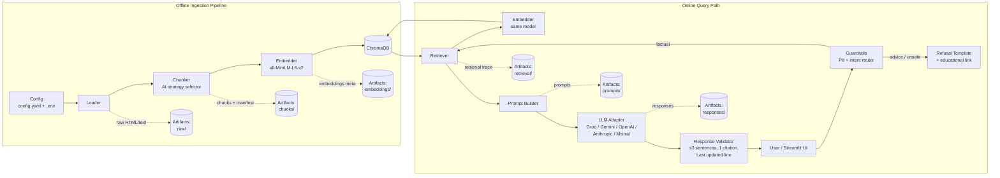
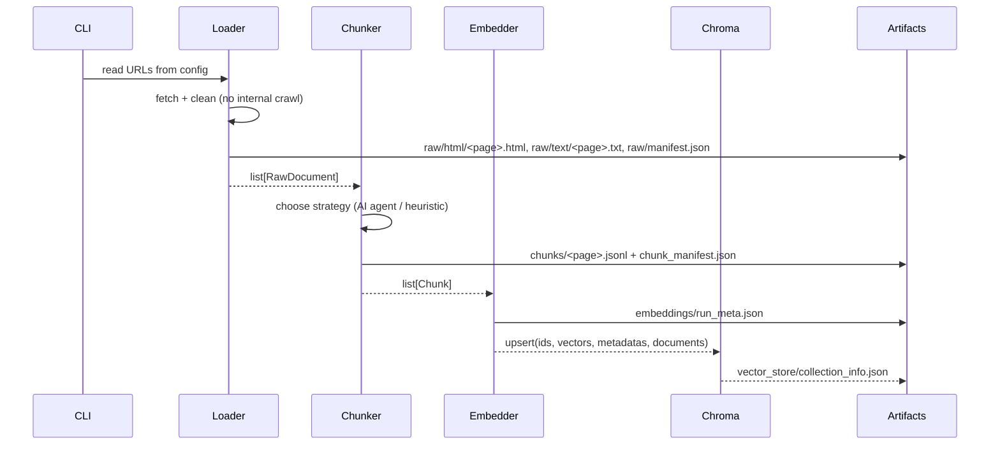
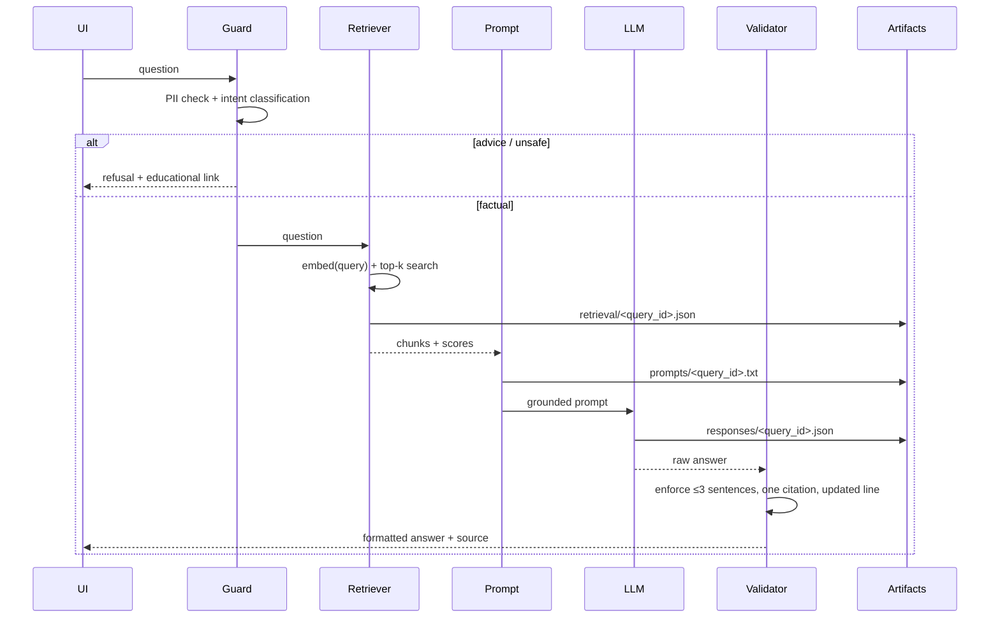

# Architecture — Groww Mutual Fund FAQ Assistant (RAG Demo)

Source of truth: `PRD.md`. This document describes how the system is structured, how data flows through each RAG stage, and the interfaces that keep components swappable via config.

---

## 1. Architectural Goals

- **Transparency by design** — every RAG stage persists an inspectable artifact.
- **Config-driven** — embedding model, vector DB, LLM provider/model are swappable without code changes.
- **Grounded answers** — answers are generated only from retrieved chunks; exactly one citation per answer.
- **Safety first** — opinionated queries are refused before generation; PII is rejected at input.
- **Small footprint** — 5-page corpus, local artifacts, runs on a laptop.

---

## 2. High-Level Architecture



---

## 3. Component Breakdown

| Component | Responsibility | Key Interfaces |
|-----------|----------------|----------------|
| `config` | Load/validate `config.yaml` + `.env`, expose typed settings | `Settings` object |
| `loader` | Fetch 5 URLs, extract cleaned text, capture metadata | `Loader.fetch(url) -> RawDocument` |
| `chunker` | Select strategy (auto/heading/fixed), produce chunks + manifest | `Chunker.run(docs) -> list[Chunk]` |
| `embedder` | Encode chunks/queries with configured model | `Embedder.encode(texts) -> vectors` |
| `vector_store` | Persist/query embeddings in ChromaDB | `VectorStore.upsert/query` |
| `retriever` | Top-k similarity search with metadata + trace | `Retriever.retrieve(query) -> Retrieved` |
| `guardrails` | PII detection, advice-intent classification, refusal templates | `Guard.check(query) -> Decision` |
| `prompt_builder` | Compose grounded prompt with context + rules | `build(query, chunks) -> str` |
| `llm` | Provider-agnostic generation adapter | `LLM.generate(prompt) -> str` |
| `validator` | Enforce answer format (sentences, one link, updated line) | `validate(answer) -> Answer` |
| `ui` | Streamlit app: welcome, examples, chat, disclaimer | — |
| `artifacts` | Standard writer for every stage's output | `ArtifactWriter.save(stage, payload)` |

---

## 4. Data Flow

### 4.1 Ingestion (offline, one command: `make ingest`)



### 4.2 Query (online)



---

## 5. Stage Artifacts (Demo Contracts)

All artifacts live under `data/artifacts/` and are versioned by `run_id` (UTC timestamp).

| Stage | Path | Contents |
|-------|------|----------|
| Loading | `raw/html/<slug>.html` | Original HTML snapshot |
| Loading | `raw/text/<slug>.txt` | Cleaned visible text |
| Loading | `raw/manifest.json` | `source_url`, `page_title`, `scheme`, `category`, `fetched_at`, `http_status` |
| Chunking | `chunks/<slug>.jsonl` | `chunk_id`, `text`, `section`, `char_count`, `token_count`, `source_url` |
| Chunking | `chunks/chunk_manifest.json` | chosen strategy, rationale, params, counts |
| Embedding | `embeddings/run_meta.json` | model, dimension, chunk count, timestamp |
| Vector store | `vector_store/collection_info.json` | provider, collection, distance metric, count |
| Retrieval | `retrieval/<query_id>.json` | query, top_k, scores, selected chunk ids |
| Generation | `prompts/<query_id>.txt` | final prompt sent to LLM |
| Generation | `responses/<query_id>.json` | provider, model, raw + validated answer, latency |
| Guardrails | `guardrails/<query_id>.json` | PII flags, intent label, decision |

---

## 6. Module / Repository Layout

```
ragchatbot/
├── PRD.md
├── architectur.md
├── README.md
├── config.yaml
├── .env.example
├── Makefile
├── requirements.txt
├── app/
│   └── streamlit_app.py
├── src/
│   ├── config.py
│   ├── artifacts.py
│   ├── ingestion/
│   │   ├── loader.py
│   │   └── chunker.py
│   ├── indexing/
│   │   ├── embedder.py
│   │   └── vector_store.py
│   ├── retrieval/
│   │   └── retriever.py
│   ├── generation/
│   │   ├── prompt_builder.py
│   │   ├── llm.py            # provider adapter
│   │   └── validator.py
│   ├── safety/
│   │   ├── pii.py
│   │   └── intent.py
│   └── pipeline.py           # ingest() and answer() orchestration
├── data/
│   ├── artifacts/
│   └── chroma/
├── docs/
│   ├── sources.md
│   └── sample_qa.md
└── tests/
    ├── test_chunker.py
    ├── test_retriever.py
    ├── test_guardrails.py
    └── test_validator.py
```

---

## 7. Data Models

### 7.1 RawDocument

```python
@dataclass
class RawDocument:
    source_url: str
    page_title: str
    scheme: str
    category: str
    html: str
    text: str
    fetched_at: datetime
```

### 7.2 Chunk

```python
@dataclass
class Chunk:
    chunk_id: str          # sha1(source_url + section + index)
    source_url: str
    scheme: str
    section: str
    text: str
    char_count: int
    token_count: int
```

### 7.3 Answer

```python
@dataclass
class Answer:
    text: str              # <= 3 sentences
    source_url: str        # exactly one
    last_updated: str      # from source fetched_at
    refused: bool
    trace_id: str
```

---

## 8. Interfaces (Swappable via Config)

```python
class Loader(Protocol):
    def fetch(self, url: str) -> RawDocument: ...

class Chunker(Protocol):
    def run(self, docs: list[RawDocument]) -> tuple[list[Chunk], dict]: ...

class Embedder(Protocol):
    def encode(self, texts: list[str]) -> list[list[float]]: ...

class VectorStore(Protocol):
    def upsert(self, chunks: list[Chunk], vectors: list[list[float]]) -> None: ...
    def query(self, vector: list[float], top_k: int) -> list[dict]: ...

class LLM(Protocol):
    def generate(self, prompt: str, **kwargs) -> str: ...
```

Factory functions resolve implementations from config:

```python
def build_embedder(cfg) -> Embedder      # sentence-transformers
def build_vector_store(cfg) -> VectorStore  # chromadb
def build_llm(cfg) -> LLM                # groq | gemini | openai | anthropic | mistral
```

---

## 9. Guardrail Design

### 9.1 PII Gate (pre-retrieval)
- Regex + lightweight heuristics for PAN (`[A-Z]{5}[0-9]{4}[A-Z]`), Aadhaar (12 digits), account numbers, OTPs, emails, phone numbers.
- On match: **do not store**, return a generic message asking the user to remove sensitive details.

### 9.2 Intent Router
- Classify into `factual` | `advice` | `off_topic`.
- Rule/keyword baseline + optional LLM classifier (configurable).
- `advice` → polite refusal + educational/official link (from allowlisted educational URLs).
- `off_topic` → scope message + link to the AMC page.

### 9.3 Answer Validator
- Enforce ≤3 sentences.
- Exactly one URL, must belong to the allowlisted source corpus.
- Append/normalize `Last updated from sources: <date>`.
- Block performance/return language (regex denylist).

---

## 10. Prompt Contract

System prompt (summarized):

```
You are a facts-only mutual fund FAQ assistant.
Use ONLY the provided context. If the answer is not in the context, say you
can't find it and give the closest official source link.
Rules:
- Answer in at most 3 sentences.
- Include exactly ONE source link.
- Never give advice, opinions, or return/performance claims.
- End with: "Last updated from sources: <date>".
```

User prompt: the question + numbered context chunks + their metadata.

---

## 11. Configuration

`config.yaml` is the single control surface; `.env` holds secrets only.

```yaml
ingestion:
  urls: [...]
  artifacts_dir: data/artifacts
  request_timeout_s: 30
  user_agent: "groww-mf-faq-demo/1.0"
  rate_limit_rps: 1
chunking:
  strategy: auto
  chunk_size: 512
  chunk_overlap: 64
embedding:
  model: sentence-transformers/all-MiniLM-L6-v2
  batch_size: 32
vector_db:
  provider: chromadb
  collection: groww_mf_faq
  persist_dir: data/chroma
  distance: cosine
retrieval:
  top_k: 5
  min_score: 0.2
llm:
  provider: groq
  model: qwen/qwen3.8-27b
  temperature: 0.1
  max_sentences: 3
guardrails:
  pii_block: true
  advice_classifier: hybrid
sources:
  allowlist: [...5 URLs...]
  educational_links: [...]
```

Environment: `GROQ_API_KEY`, optional `GEMINI_API_KEY`, `OPENAI_API_KEY`, `ANTHROPIC_API_KEY`, `MISTRAL_API_KEY`.

---

## 12. Deployment & Runtime

- **Prototype:** local Streamlit app (`make run`) + CLI (`make ingest`, `make ask "..."`).
- **Storage:** local filesystem for artifacts and Chroma persistence.
- **Optional demo mode:** static artifacts viewer page to show each stage's stored data.
- No server-side PII storage; no database of user queries retained beyond artifacts needed for demo traces (trace files contain questions only, PII-gated).

---

## 13. Error Handling & Resilience

| Scenario | Behavior |
|----------|----------|
| Fetch failure / 4xx-5xx | Retry with backoff; persist failure in `raw/manifest.json`; skip and continue |
| Empty/JS-rendered page | Fallback to plain-text extraction; flag `extraction_warning` |
| LLM provider error | Retry once; fallback provider if configured; else return grounded extractive answer |
| No chunks above `min_score` | Respond "not found in provided sources" + AMC link |
| Citation missing/invalid | Validator injects the top chunk's `source_url` |
| PII detected | Reject query, no logging of the sensitive value |

---

## 14. Testing Strategy

- **Unit:** chunk boundaries, token counts, PII regex, intent classification, validator rules.
- **Integration:** ingest → chunk → embed → Chroma → retrieve on the 5 pages.
- **Golden Q&A:** 5–10 sample queries with expected facts + correct source link.
- **Safety tests:** advice queries must be refused; PII inputs must be rejected.
- **Config tests:** swap embedding model / vector DB / LLM via config without code edits.

---

## 15. Extensibility

- Add new schemes by appending URLs to `ingestion.urls` + allowlist.
- Replace Chroma with FAISS/pgvector by implementing `VectorStore`.
- Add providers by implementing `LLM` and registering in the factory.
- Improve chunking by adding a strategy class and selecting it in config/manifest.
- Add an evaluation harness reading `retrieval/` + `responses/` traces.

---

## 16. Traceability (PRD → Architecture)

| PRD requirement | Architecture element |
|-----------------|----------------------|
| Phase 1 Loading | `loader.py`, `raw/` artifacts |
| Phase 2 Chunking (AI strategy) | `chunker.py`, `chunk_manifest.json` |
| Phase 3 Embedding (`all-MiniLM-L6-v2`) | `embedder.py`, `embeddings/run_meta.json` |
| Phase 4 Vector DB (ChromaDB) | `vector_store.py`, `data/chroma` |
| Phase 5 Retrieval (same model/DB) | `retriever.py`, `retrieval/` traces |
| Phase 6 Generation (Groq + abstractions) | `llm.py`, `prompt_builder.py`, `responses/` |
| Config-driven models/DB/LLM | `config.py`, `config.yaml`, factories |
| Facts-only + refusal | `guardrails/`, `validator.py`, refusal templates |
| ≤3 sentences + one citation + updated line | `validator.py` |
| No PII | `safety/pii.py` |
| Tiny UI + disclaimer | `app/streamlit_app.py` |
